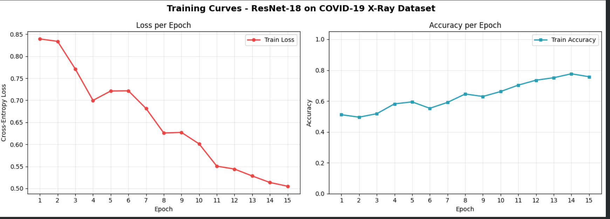
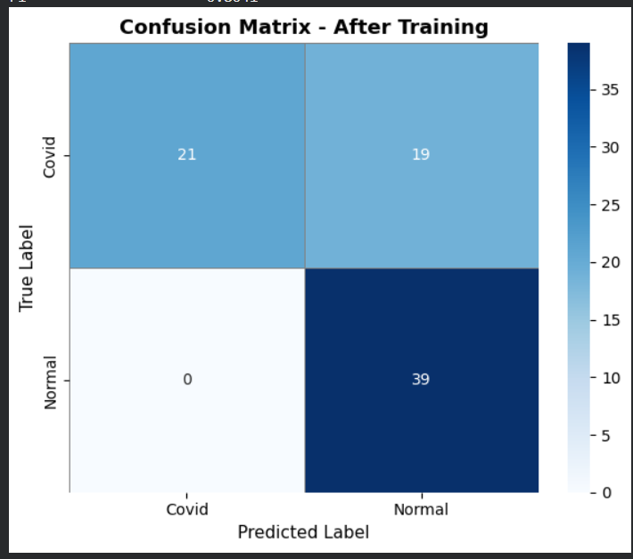

# COVID Chest X-Ray Classification with ResNet-18

## Project
This project trains a binary image classifier using PyTorch and transfer learning with ResNet-18 to classify chest X-ray images into `Covid` and `Normal` classes. It could be used as an early screening-support tool by doctors and healthcare professionals, alongside students and learners exploring medical image classification (not a standalone clinical diagnosis).

## Dataset
- **Source:** [COVID X-Ray Dataset on Kaggle](https://www.kaggle.com/datasets/whysodarkbro/covid-xray-dataset)
- **Images & Classes:** 392 images across 2 classes (`{'Covid': 0, 'Normal': 1}`)
- **Split:** Stratified 80% / 20% split into **313 training samples** (10 batches of size 32) and **79 test samples** (3 batches of size 32)

## Model
- **Architecture:** Pretrained `ResNet-18` (`IMAGENET1K_V1`) with frozen backbone layers and a new classification head (`Dropout(p=0.5)` + `Linear`)
- **Trainable Parameters:** 1,026 / 11,177,538
- **Settings:** `epochs = 15`, `learning_rate = 0.0001` (`1e-4`), `batch_size = 32`, `CrossEntropyLoss`, and `Adam` optimizer

## Results
The training curves show that the model is **still learning**, with training loss decreasing from `0.8392` (epoch 1) to `0.5050` (epoch 15) and training accuracy rising from `0.5112` to `0.7572`.

| Metric | Before Training | After Training | Change |
| :--- | :---: | :---: | :---: |
| Loss | 1.0007 | 0.4701 | -0.5306 |
| Accuracy | 0.3544 | 0.7595| +0.4051 |
| Precision | 0.4118 | 0.6724 | +0.2606 |
| Recall | 0.7179 | 1.0000| +0.2821 |
| F1 | 0.5234 | 0.8041 | +0.2808 |

After training on the same 79-image test set, loss dropped by `-0.5306`, accuracy improved by `+0.4051` (from `0.3544` to `0.7595`), and F1 increased by `+0.2808` (from `0.5234` to `0.8041`). This happened because training the new head over 15 epochs adapted ResNet-18 features to chest X-ray images, while the confusion matrix shows 39/39 `Normal` images predicted correctly and 21/40 `Covid` images predicted correctly (with 19 `Covid` images misclassified as `Normal`).

## How to run
Group the Kaggle dataset into a single folder split into two class folders (`Covid` and `Normal`), compress it into a zip archive, and update the archive path if needed so the code extracts and splits the data (80% train / 20% test). Then open `project.ipynb` in Colab, set the runtime to GPU, run all.
